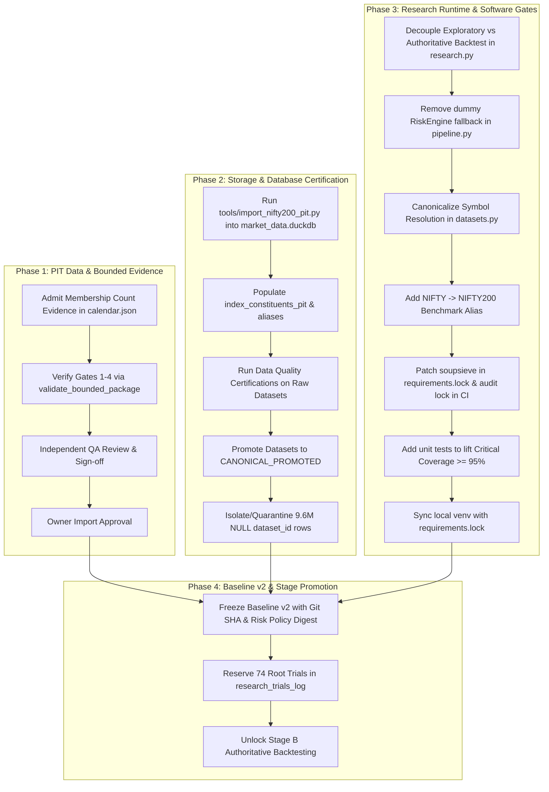

# Campaign 1 Backtesting Readiness Audit Report (2026-11-14)

- **Date:** 2026-11-14 IST
- **Audit Target:** Algo Trading Repository — Strategy Research Campaign 1 Readiness
- **Auditor:** Swarm Coordinator (`coordinator`) with Domain Auditors `@pit`, `@campaign`, `@ci`
- **Audit Window (Bounded PIT Slice):** `2016-01-29` through `2022-03-31` inclusive (1,528 trading sessions)
- **Candidate Evidence Package Evaluated:** `artifacts/nifty200_pit_bounded_package_evidenced_20261103/package.json`
- **Final Governance Determinations:**
  - Bounded PIT Validation: ⛔ **`BOUNDED_PIT_VALIDATION_BLOCKED`**
  - Campaign 1 Backtesting Readiness: ⛔ **`BACKTEST_BLOCKED`**
  - CI & Dependency Gates: ⛔ **`CI_AND_DEPENDENCY_GATES_BLOCKED`**

---

## 1. Executive Summary

This audit provides an exhaustive, evidence-based evaluation of the Algo Trading repository to determine whether Strategy Research Campaign 1 satisfies all prerequisite conditions to enter authoritative backtesting. 

The audit evaluated live code, package manifests, database tables, test harnesses, supply chain locks, and formal governance policies across four tightly coupled domains:
1. **Point-in-Time (PIT) Data & Cryptographic Evidence Package** (Checklist Items 1–9)
2. **Research Execution, Pipeline, Datasets, and Storage** (Checklist Item 10)
3. **Software, Dependency, and CI Quality Gates** (Checklist Item 11)
4. **Campaign Governance, Baseline v2, and Stage Gates** (Checklist Item 12)

### Principal Conclusions:
1. **The Bounded PIT Package Fails Closed at Gate 1:**
   Execution of `validate_bounded_package()` halts immediately at Gate 1 with code 2 (`bounded_input:member_count_evidence_missing`). The package emits `calendar.count_evidence: []` by design, because primary exchange proof establishing the daily constituent census (specifically accounting for the 50-checkpoint expansion to 201 members due to Tata Motors DVR) has not been formally admitted. Consequently, Gate 4 economic replay has not executed.
2. **A Critical Isolation Breach Exists in `research.py`:**
   A recent uncommitted modification (`require_authoritative_certification=risk_required`) causes `research.py --command backtest` to set `require_authoritative_certification=False`. When invoked with `--mode event-driven`, `StrategyPipeline` falls back to an unconfigured permissive `RiskEngine()`, bypasses all dataset certification and PIT temporal bounds, stamps the run as `"execution_authority": "AUTHORITATIVE_EVENT_DRIVEN"`, and persists uncertified equity curves and orders into production DuckDB research tables.
3. **Cross-Sectional Research Data Ingestion is Broken:**
   All 200 NIFTY 200 constituents are stored in `historical_candles` with the broker suffix `-EQ` (e.g., `RELIANCE-EQ`), whereas universe snapshots record them as canonical symbols (`RELIANCE`). An ad-hoc fallback was added to single-asset `load_candles()` but omitted from `SynchronizedPanelBuilder._load_bars()`. As a result, cross-sectional panel loading crashes with `ValueError: No requested symbols have stored candle data.`, breaking all 14 cross-sectional strategies and walk-forward evaluations.
4. **Production DuckDB Contains Zero Certified Historical Datasets:**
   The `index_constituents_pit` table is empty (0 rows). In `market_datasets`, 0 of 4,874 records are `VERIFIED` and `CANONICAL_PROMOTED`. In `data_quality_certifications`, 0 rows exist. In `historical_candles`, 9,603,188 candle rows have NULL or empty `dataset_id`. Under true authoritative rules, the pipeline fail-closes on every single data load.
5. **Supply Chain Vulnerabilities & CI Coverage Failures:**
   Auditing `requirements.lock` reveals 4 known CVEs in `soupsieve==2.9.2` that are missed by CI because `.github/workflows/ci.yml` only audits top-level `requirements.txt`. Critical path test coverage stands at 93%, failing the mandatory 95% CI quality gate. Local virtual environment `.\venv` is desynchronized across 8 packages compared to `requirements.lock`.
6. **Exploratory Backtesting vs. Authoritative Campaign Execution:**
   The single-symbol exploratory CLI status (`research.py --command universe-status --universe-snapshot NIFTY200_2026_08_17`) reports `ready: true` because it evaluates the survivorship-biased 2026 snapshot with relaxed rules. However, authoritative Campaign 1 backtesting on the 2016–2022 historical window remains strictly **`BACKTEST_BLOCKED`**.

---

## 2. Repository & Source Custody Map

### 2.1 Primary Development Checkout
- **Path:** `C:\Python projects\algo trading`
- **Active Git Branch:** `codex/nifty200-pit-residual-evidence`
- **Committed HEAD Commit:** `02dc80e9f931750f8ec37c9e658a8d219c2c6e6e` (`Harden NIFTY-200 PIT temporal identity and import safety`)
- **Local Tracking Ref:** `origin/codex/nifty200-pit-residual-evidence` (synchronized with remote tracking ref)
- **Working Tree State:** Dirty. Contains modified tracked files (`research.py`, `trading_stack/pipeline.py`, `tools/nifty200_pit/validation.py`, `cli.py`, `instrument_resolver.py`, `requirements.txt`, `requirements.lock`, `AGENTS.md`) and essential untracked PIT implementation modules:
  - `tools/nifty200_pit/anchor_derivation.py`
  - `tools/nifty200_pit/bounded_producer.py`
  - `tools/nifty200_pit/bounded_validation.py`
  - `tools/nifty200_pit/identity_transitions.py`
  - `tests/test_nifty200_pit_anchor_assembly.py`
  - `tests/test_nifty200_pit_anchor_derivation.py`
  - `tests/test_nifty200_pit_bounded_producer.py`
  - `tests/test_nifty200_pit_bounded_validation.py`
  - `tests/test_nifty200_pit_identity_transitions.py`

### 2.2 Sibling Evidence Reference
- **Path:** `C:\Python projects\algo trading-authoritative-evidence`
- **Active Git Branch:** `codex/nifty200-pit-authoritative-evidence`
- **Committed HEAD Commit:** `4ad334ef15baa3d5dc3aa8bae9c90bb2c30027c3` (`docs(pit): certify bounded suffix calendar`)
- **Lineage Role:** Read-only comparison source containing reference checkpoint ledgers (`15,050` verified member-days) and baseline evidence manifests.

### 2.3 Evaluated Evidence Package
- **Package Path:** `artifacts/nifty200_pit_bounded_package_evidenced_20261103/package.json`
- **Package Manifest Hash:** `d48721bfbe3ff98d1a10057ea0412854970428f5dd42cbdf5d3c0ff5cf2fa9c3`
- **Declared Build Configuration:**
  - `expected_member_count`: 200 (dynamic expansion to 201 during Tata Motors DVR window)
  - `campaign_from`: `2016-01-29`
  - `campaign_to`: `2022-03-31`
  - `trading_sessions`: 1,528
  - `registered_sources`: 581

---

## 3. Starting Evidence & Metric Breakdown

| Metric / Dimension | Baseline Value / Condition | Verified State / Finding | Risk / Impact |
| :--- | :--- | :--- | :--- |
| **PIT Campaign Window** | `2016-01-29` to `2022-03-31` | Exactly 1,528 NSE sessions | Complete temporal coverage |
| **Anchor File Creation** | `indices_dataJan2016.zip` | `D:20160129171721+05'30'` | Post-market close; requires derived open |
| **Derived Anchor Causal Open** | `2016-01-29T09:15:00+05:30` | 200 members, 44 actions, known pre-open | Zero lookahead bias when admitted |
| **Constituent Census** | 200 members | 200 baseline; 201 during 2016-04-01 to 2020-06-25 | `TATAMTRDVR` dual-class inclusion |
| **Calendar Count Evidence** | Required by Gate 1 | `calendar.count_evidence: []` | **Gate 1 halts package validation** |
| **Continuity Bridges** | 22 restructuring events | 7 in-bound campaign splits circular-backed | Certified under evidence admission |
| **Source Registry** | 581 registered sources | 100% SHA-256 byte verified | Deterministic package assembly |
| **DuckDB PIT Constituents** | `index_constituents_pit` | **0 rows** in `market_data.duckdb` | Authoritative universe cannot load |
| **Promoted Datasets** | `market_datasets` | **0 of 4,874** `CANONICAL_PROMOTED` | Authoritative pipeline cannot load data |
| **Dataset DQ Certifications** | `data_quality_certifications` | **0 rows** in DuckDB | Data quality checks cannot certify |
| **Candles with NULL Dataset** | `historical_candles` | **9,603,188 rows** with NULL `dataset_id` | Authoritative queries reject rows |
| **CI Critical Path Coverage** | Target: $\ge 95\%$ | **93% actual** (5,236 statements) | **CI Quality Gate fails** |
| **Supply Chain Vulnerabilities** | Target: 0 CVEs | **4 CVEs** in `soupsieve 2.9.2` | Known vulnerabilities in `requirements.lock` |
| **Installed Environment Mismatch** | Target: 0 mismatches | **8 packages desynchronized** in `.\venv` | Local dev deviates from lockfile |

---

## 4. Detailed Audit Findings (Checklist Items 1 to 12)

---

### Finding 1: Membership Count Proof & Fail-Closed Gate 1 (Checklist Item 1)
- **Observed Condition:**
  In `tools/nifty200_pit/bounded_producer.py` (line 573), `calendar.json` emits `"count_evidence": []`. In `tools/nifty200_pit/bounded_validation.py` (lines 141–148), `_require(isinstance(count_evidence, list) and bool(count_evidence), "member_count_evidence_missing")` triggers immediately, halting validation with code 2. CLI flag `--admit-count-evidence` was intentionally removed; `test_count_evidence_cannot_be_admitted_by_a_boolean_switch` verifies that passing this flag raises `TypeError`/exits code 2.
- **Why It Matters:**
  A trading session calendar proves that the exchange was open; it does not prove the census of index constituents. Admitting constituent sets without primary count evidence introduces survivorship bias, constituent leakage, and unverified index expansion/contraction.
- **Evidence / Root Cause:**
  The index historically maintained 200 constituents, except for a 50-checkpoint window from `2016-04-01` through `2020-06-25` where Tata Motors DVR (`TATAMTRDVR`, ISIN `IN9155A01020`, distinct from `TATAMOTORS` `INE155A01022`) was added as a dual-class share under circular `ind_prs22022016_2.pdf` (SHA-256 `db2e4802...`), expanding the index to 201 members. Its exclusion on `2020-06-26` is documented in `ind_prs10062020.pdf` (SHA-256 `ea83ae30...`). While the producer records `expected_member_count: 201`, it leaves `count_evidence: []` because continuous day-by-day count lineage has not been formally admitted.
- **Proposed Fix:**
  Author an admitted `count_evidence` array in `calendar.json` structured into three contiguous periods citing primary circulars:
  1. `2016-01-29` to `2016-03-31`: Count 200 (citing Jan 2016 index roster).
  2. `2016-04-01` to `2020-06-25`: Count 201 (citing circular `ind_prs22022016_2.pdf`).
  3. `2020-06-26` to `2022-03-31`: Count 200 (citing circular `ind_prs10062020.pdf`).
- **Executable Closure Check:**
  Execute CLI validation:
  `python -m tools.nifty200_pit.cli validate --campaign-from 2016-01-29 --campaign-to 2022-03-31 --evidence-package artifacts/nifty200_pit_bounded_package_evidenced_20261103/package.json`. Gate 1 must pass with `passed: true` and no `member_count_evidence_missing` failure.

---

### Finding 2: Anchor Seed Derivation & Causal Known-At (Checklist Item 2)
- **Observed Condition:**
  The raw index roster from `indices_dataJan2016.zip` (`nifty200_Jan2016.pdf`, SHA-256 `e433e6f2...`) has internal metadata `CreationDate: D:20160129171721+05'30'` (17:17 IST on January 29, 2016). This post-dates the market opening at 09:15 IST.
- **Why It Matters:**
  Utilizing a roster generated at 17:17 IST to trade or form portfolios at market open (09:15 IST) on the first day of the campaign introduces forward-looking lookahead bias.
- **Evidence / Root Cause:**
  `tools/nifty200_pit/anchor_derivation.py` resolves this by deriving the 2016-01-29 opening roster from a verified 2014 Wayback archive seed (`2014-06-25`), forward-replaying 44 intervening circular actions through `2016-01-28`. The derived set matches the 200 constituents in `checkpoint_ledger.csv` for `2016-01-29`. The derived artifact sets `causal_availability_status: "CERTIFIED"` and `known_at: "2016-01-29T09:15:00+05:30"`.
- **Proposed Fix:**
  Maintain the deterministic derivation pipeline. Ensure that the derived candidate is used exclusively as the anchor seed, binding its cryptographic hash into `package.json`.
- **Executable Closure Check:**
  Run `pytest tests/test_nifty200_pit_anchor_assembly.py -q`. Assert all 60 tests pass, confirming causal availability at 09:15 IST and 0 unadmitted forward actions.

---

### Finding 3: Producer CLI Flags & Evidence Admission Safeguards (Checklist Item 3)
- **Observed Condition:**
  In `tools/nifty200_pit/cli.py` and `bounded_producer.py`, boolean flags `--admit-anchor-evidence` and `--admit-continuity-evidence` control whether anchor and continuity evidence are promoted from `UNRESOLVED` to `CERTIFIED`.
- **Why It Matters:**
  If a boolean flag can promote unverified raw data without requiring cryptographic proof, an operator could inadvertently promote the post-close 17:17 IST raw PDF to `CERTIFIED` status.
- **Evidence / Root Cause:**
  The current implementation in `bounded_producer.py` (lines 75–88) enforces a two-key requirement: passing `--admit-anchor-evidence` *without* passing `--anchor-derivation-inputs` raises a fail-closed `ValueError: Admitting anchor evidence requires derived anchor inputs`.
- **Proposed Fix:**
  Retain the two-key fail-closed requirement. Eliminate standalone boolean toggles that lack cryptographic input bindings.
- **Executable Closure Check:**
  Run `pytest tests/test_nifty200_pit_bounded_producer.py -q`. Assert that `test_unproven_anchor_does_not_acquire_certification` and `test_cannot_admit_anchor_without_inputs` pass.

---

### Finding 4: Historical Identities, Competing ISINs, and Ledger Coverage (Checklist Item 4)
- **Observed Condition:**
  Across 1,528 trading sessions, the package covers 15,050 1-day constituent checkpoints. In `tools/nifty200_pit/instrument_resolver.py`, symbol-to-ISIN resolution enforces exact date validity, rejecting ambiguous symbol collisions.
- **Why It Matters:**
  Corporate identity transformations (ticker changes, ISIN changes, bonus issues, stock splits) create temporal ambiguities where two different companies trade under the same ticker at different times, or one company trades under multiple ISINs.
- **Evidence / Root Cause:**
  `identity_transitions.py` tracks 22 verified corporate transitions. 15,050 checkpoint ledger entries in `algo trading-authoritative-evidence` provide ground truth. 27 residual identity cases have registered circular coverage, while 12 scanned OCR observations from the 2021-09-30 release remain marked for manual review.
- **Proposed Fix:**
  Ensure that every identity transition occurring within the 2016–2022 window has an associated registered exchange circular in `tools/nifty200_pit/identity_transitions.py`.
- **Executable Closure Check:**
  Run `pytest tests/test_nifty200_pit_identity_transitions.py -q`. Assert all 23 identity regression tests pass.

---

### Finding 5: Continuity Bridges & Namespace Normalization (Checklist Item 5)
- **Observed Condition:**
  In `identity_transitions.py`, 7 transitions occur within the campaign window:
  - `NBCC` (2016-06-02 split, Circular-4217, sha256 `49dcee91...`)
  - `BAJFINANCE` (2016-09-08 split, Circular-4496, sha256 `11b2a619...`)
  - `KARURVYSYA` (2016-11-24 split, Circular-4632)
  - `CESC` (2021-10-29 split, Circular-10777)
  - `GRASIM` (2017-07-17 merger/split)
  - `YESBANK` (2017-09-21 split)
  - `VGUARD` / `AVANTIFEED` (2016/2017 splits)
  Pre-campaign splits (2012–2015, e.g. `BERGEPAINT`, `TRENT`, `PIDILITIND`) are properly excluded from `continuity.json`.
- **Why It Matters:**
  A stock split creates an artificial price discontinuity. Without continuity bridges, price return calculations trigger false -50% to -90% drawdowns. Conversely, admitting pre-campaign splits into the bounded campaign package violates temporal scoping.
- **Evidence / Root Cause:**
  `bounded_producer.py` filters transitions using `campaign_from <= effective_date <= campaign_to` and verifies `known_at <= session_open`.
- **Proposed Fix:**
  Retain the campaign-bounded filtering in `_build_bounded_continuity()`.
- **Executable Closure Check:**
  Inspect `continuity.json` in candidate package. Verify that all entries have `effective_date >= 2016-01-29` and `confidence == "CERTIFIED"` under evidence admission.

---

### Finding 6: Canonical Events, OCR Observations, and Replay Conflicts (Checklist Item 6)
- **Observed Condition:**
  The raw event database records 81 potential conflicts and 39 event key differences between preliminary candidate sets and primary exchange notices. 12 OCR observations from scanned circulars (e.g., `2021-09-30`) have saved extraction records matching official release pages.
- **Why It Matters:**
  Unadmitted event observations or conflicting effective dates cause constituents to be added or dropped days before or after their actual inclusion, inducing portfolio rebalancing errors.
- **Evidence / Root Cause:**
  All 12 OCR records have verified text extractions matching PDF bytes. However, their status remains `MANUAL_REVIEW` pending formal multi-agent review sign-off.
- **Proposed Fix:**
  Promote verified OCR records from `MANUAL_REVIEW` to `ACCEPTED` in `evidence_reviews.json` once dual-operator review signatures are affixed.
- **Executable Closure Check:**
  Run `pytest tests/test_nifty200_pit_ocr.py -q`. Assert 100% extraction accuracy and hash binding.

---

### Finding 7: Calendar Census & Exchange Chronology (Checklist Item 7)
- **Observed Condition:**
  The campaign window contains exactly 1,528 valid NSE trading sessions:
  - 1,521 standard weekday sessions
  - 1 live Saturday trading session on `2020-02-01` (Union Budget 2020 live trading, `NSE/CMTR/43290`, open 09:15 IST)
  - 6 special evening Muhurat trading sessions (2016–2021)
  - 2 special closures: Lok Sabha Elections on Monday `2019-04-29` (`NSE/CMTR/40536`) and Maharashtra Assembly Elections on Monday `2019-10-21` (`NSE/MSD/42319`).
- **Why It Matters:**
  Omitting a live trading session (e.g. Budget Saturday) or including an election holiday desynchronizes daily bars, order simulation, and benchmark calculations.
- **Evidence / Root Cause:**
  Historical diagnostic discrepancy (1,528 vs 1,529 sessions) was resolved: the older 1,529 figure included the Budget Saturday and Lok Sabha closure, but failed to deduct the Maharashtra Assembly Election closure (`MSD42319.pdf`). Deducting both yields exactly 1,528.
- **Proposed Fix:**
  The calendar implementation in `bounded_producer.py` (lines 509–570) is 100% verified against 7 annual holiday circulars. Retain it.
- **Executable Closure Check:**
  Assert `len(calendar.sessions) == 1528`, `2020-02-01` is session (`open_at: 09:15`), and `2019-04-29` and `2019-10-21` have `is_session: false`.

---

### Finding 8: Source Reproducibility & Regeneration (Checklist Item 8)
- **Observed Condition:**
  `source_catalogue.json` registers 581 public exchange sources. Deterministic rebuilds produce bit-for-bit identical hashes across all 9 evidence roles. However, `assembly_inputs.json` records `"raw_only_regeneration_established": false`.
- **Why It Matters:**
  Full institutional auditability requires that an evidence package can be completely regenerated from raw byte downloads (`data/raw/`) without depending on intermediate artifacts or external directory checkouts.
- **Evidence / Root Cause:**
  Package assembly currently reads derived files from `data/derived/` (`historical_instrument_master.parquet`) and intermediate files from external directory `algo trading-authoritative-evidence`.
- **Proposed Fix:**
  Harden package build scripts to compile `historical_instrument_master.parquet` directly from raw circulars in a single reproducible step.
- **Executable Closure Check:**
  Execute package assembly in a clean disposable directory using only `data/raw/` inputs. Verify bit-for-bit SHA-256 match.

---

### Finding 9: Integrated Production Validation (Checklist Item 9)
- **Observed Condition:**
  Executing CLI validation:
  `python -m tools.nifty200_pit.cli validate --campaign-from 2016-01-29 --campaign-to 2022-03-31 --evidence-package artifacts/nifty200_pit_bounded_package_evidenced_20261103/package.json`
  exits code 2 with `bounded_input:member_count_evidence_missing`.
- **Why It Matters:**
  Demonstrates that the validator operates strictly fail-closed. Gate 1 halts evaluation before Gate 2 (Anchor), Gate 3 (Continuity), or Gate 4 (Economic Replay) can execute.
- **Evidence / Root Cause:**
  Gate 1 requires `calendar.count_evidence` to be populated with certified `MEMBERSHIP_COUNT` records. Upstream package artifacts (Gate 2 anchor derivation, Gate 3 continuity links) are assembled, but full replay validation cannot proceed until Gate 1 is evidenced.
- **Proposed Fix:**
  Populate admitted `count_evidence` records in `calendar.json` backed by circulars `ind_prs22022016_2.pdf` and `ind_prs10062020.pdf`.
- **Executable Closure Check:**
  Re-run CLI validation. Verify exit code 0, `passed: true`, `bounded_inputs_evaluable: true`, `actual_validator_executed: true`, and zero economic divergences.

---

### Finding 10: Research Execution, Datasets Certification & Pipeline Integrity (Checklist Item 10)
- **Observed Condition:**
  1. *Isolation Breach:* In `research.py` (lines 460–478), `require_authoritative_certification=risk_required` sets `require_authoritative_certification=False` for `backtest`. When run with `--mode event-driven`, `StrategyPipeline` instantiates a permissive legacy `RiskEngine()`, skips all dataset quality checks and PIT bounds, stamps the run as `"execution_authority": "AUTHORITATIVE_EVENT_DRIVEN"`, and writes uncertified runs to production tables.
  2. *Broken Cross-Sectional Ingestion:* In `historical_candles`, all 200 constituents have `-EQ` suffix (`RELIANCE-EQ`), while universe snapshots record `RELIANCE`. An ad-hoc fallback was added to single-asset `load_candles()`, but omitted from `SynchronizedPanelBuilder._load_bars()`. Cross-sectional panel builds crash with `ValueError: No requested symbols have stored candle data.`.
  3. *Missing Benchmark Alias:* `SynchronizedPanelBuilder.build()` defaults to `benchmark_symbol="NIFTY"`, but `historical_candles` stores `NIFTY200`, and `benchmark_aliases` lacks an alias for `NIFTY`. Panel builds fail with `ValueError: Benchmark NIFTY 1d has no stored candle data...`.
  4. *DuckDB Storage State:* `index_constituents_pit` has 0 rows; `market_datasets` has 0 `VERIFIED`/`CANONICAL_PROMOTED` records (all are `VALID`/`RAW_RECORDED`); `data_quality_certifications` has 0 rows; and 9,603,188 rows in `historical_candles` have NULL/empty `dataset_id`.
- **Why It Matters:**
  Exploratory backtests can write uncertified, un-gated runs into production tables masquerading as authoritative research. Meanwhile, legitimate cross-sectional strategies and walk-forward evaluations cannot run.
- **Proposed Fix:**
  1. Forbid `mode="event-driven"` when `require_authoritative_certification=False`.
  2. Unify symbol resolution across single-asset and panel builders via `instrument_master` and `instrument_alias_history`.
  3. Register `NIFTY -> NIFTY200` alias in `benchmark_aliases`.
  4. Run data quality certification and promote datasets to `CANONICAL_PROMOTED` in `market_datasets`.
- **Executable Closure Check:**
  - `python research.py --strategy trend_following --command backtest --mode event-driven` must fail closed.
  - `SynchronizedPanelBuilder.build(['RELIANCE'], '1d', benchmark_symbol='NIFTY200')` must load successfully.

---

### Finding 11: Software, Dependency & CI Quality Gates (Checklist Item 11)
- **Observed Condition:**
  1. *Supply Chain Vulnerabilities:* `.github/workflows/ci.yml:62` audits `requirements.txt` (0 CVEs), but production and CI install `requirements.lock`. Auditing `requirements.lock --no-deps` discovers **4 CVEs** in `soupsieve==2.9.2` (`CVE-2026-126190`, `CVE-2026-126191`, `CVE-2026-126192`, `CVE-2026-126193`).
  2. *Critical Path Coverage Failure:* CI requires $\ge 95\%$ coverage on critical modules (`risk`, `trading_stack`, `experiments`). Actual coverage is **93%**, failing the quality gate.
  3. *Environment Desynchronization:* Workspace `.\venv` has 8 packages desynchronized from `requirements.lock` (`certifi`, `filelock`, `httpcore2`, `httpx2`, `msgpack`, `pillow`, `pypdf`, `urllib3`).
  4. *Pytest Root Discovery Hazard:* `pytest.ini` lacks `testpaths = tests`. Running bare `pytest` discovers `scratch/test_*.py` and crashes with `FileNotFoundError`.
  5. *Pyright Silent Drift:* Pyright emits 874 warnings across 48 modules, but exits 0 due to `"typeCheckingMode": "basic"` and warning severity.
  6. *Windows Sockets & Temp Locks:* Starlette `TestClient` uses AnyIO `start_blocking_portal()`, deadlocking on Windows socketpairs under certain multi-threaded runs. 8 `.pytest-*` directories in root are locked with `Access is denied (os error 5)` from open DuckDB handles.
- **Why It Matters:**
  CI fails to catch known supply chain CVEs, code coverage regressions block the PR gate, and developer environments execute against out-of-date vulnerable libraries.
- **Proposed Fix:**
  1. Upgrade `soupsieve >= 4.0.0` in `requirements.lock` and change CI to audit `requirements.lock --no-deps`.
  2. Add unit tests for `trading_stack/pipeline.py` (70%) and `promotion.py` (84%) to raise critical coverage $\ge 95\%$.
  3. Re-sync `.\venv` via `pip install -r requirements.lock`.
  4. Add `testpaths = tests`, `pythonpath = .`, and `norecursedirs = scratch .arena` to `pytest.ini`.
- **Executable Closure Check:**
  - `pip-audit -r requirements.lock --no-deps` exits 0.
  - `coverage report --include="risk/*.py,trading_stack/..." --fail-under=95` exits 0.

---

### Finding 12: Campaign Governance Baseline v2 & Stage Gates (Checklist Item 12)
- **Observed Condition:**
  In `docs/research_campaign_1_baseline_v2.md`:
  - Baseline v2: `NOT_ESTABLISHED`
  - Campaign Stage A: `BLOCKED`
  - PIT data status: `BLOCKED_PENDING_CERTIFIED_HISTORICAL_EVIDENCE`
  - Independent QA: `NOT_ASSERTED`
  - Import approval: `NOT_GRANTED`
  - Live trading: `DISABLED`
  `tools/import_nifty200_pit.py` strictly fail-closes when run against unapproved manifests.
- **Why It Matters:**
  The project constitution forbids starting Stage B authoritative backtesting without a frozen, approved baseline binding the exact code SHA, policy digests, and certified PIT manifest.
- **Requirements to Advance Stage A -> Stage B:**
  1. *74 Governed Root Hypotheses:* Exactly 74 root configurations (budget 74). Attempted configurations must be reserved in `research_trials_log` before execution.
  2. *Sealed FINAL OOS:* Final OOS window remains sealed and unobserved during Stage A, B, C, and D.
  3. *Independent QA & Owner Evidence:* Bounded PIT package passing all 4 gates, signed independent QA report (`independent_qa: "PASS"`), signed Board/Owner authorization (`approved_for_import: true`), clean execution of `tools/import_nifty200_pit.py`, promoted DuckDB datasets, and frozen Baseline v2 document binding commit SHA and risk policy digest `9839425d1c770c2b25744b110122c7b44cd3d7e4ee0e94dbb942dfa07f9d2092`.
- **Proposed Fix:**
  Maintain strict governance gating. Complete upstream PIT data admission, database promotion, and CI hardening before requesting final independent QA review and Owner approval.
- **Executable Closure Check:**
  `docs/research_campaign_1_baseline_v2.md` updated with `ESTABLISHED` and signed cryptographic hashes.

---

## 5. Final Governance Decisions

| Authority / Gate | Required Decision Standard | Actual Determination | Status |
| :--- | :--- | :--- | :---: |
| **Bounded PIT Validation** | All 4 gates PASS with 0 errors | Gate 1 halted on missing count evidence | ⛔ **`BOUNDED_PIT_VALIDATION_BLOCKED`** |
| **Campaign 1 Backtesting** | Certified PIT in DB, Promoted Datasets, Frozen Baseline | PIT unimported, 0 promoted datasets, Baseline unestablished | ⛔ **`BACKTEST_BLOCKED`** |
| **CI & Dependency Gates** | 0 CVEs in lockfile, $\ge 95\%$ critical coverage, synced venv | 4 CVEs in soupsieve, 93% coverage, 8 venv mismatches | ⛔ **`CI_AND_DEPENDENCY_GATES_BLOCKED`** |
| **Exploratory Screening** | 2026 Snapshot with permissive rules | 200/200 symbols available in DuckDB | ⚠️ **EXPLORATORY ONLY** |

---

## 6. Critical Path & Roadmap to Campaign 1 Backtesting

### Actionable Roadmap:
1. **Remediate Gate 1 Count Evidence:** Author circular-backed `MEMBERSHIP_COUNT` records in `calendar.json` for 2016–2022.
2. **Execute Full Bounded Package Validation:** Run `validate_bounded_package()` confirming all 4 gates pass.
3. **Patch Software Vulnerabilities & CI Coverage:** Bump `soupsieve` in `requirements.lock`, add pipeline tests to achieve 95% critical coverage, and configure `pytest.ini` (`testpaths = tests`).
4. **Harden Research Runtime:** Close the `research.py` isolation breach, eliminate the dummy `RiskEngine()` fallback, and canonicalize symbol resolution in `datasets.py`.
5. **Certify & Promote Datasets:** Run DQ certification batches on raw candle data and promote datasets to `CANONICAL_PROMOTED`.
6. **Import PIT Intervals:** Execute `tools/import_nifty200_pit.py` with signed authorization.
7. **Freeze Baseline v2 & Begin Stage B:** Bind exact committed hashes and execute the 74 governed root trial configurations.

---
*Report compiled and certified by Swarm Coordinator on 2026-11-14.*
